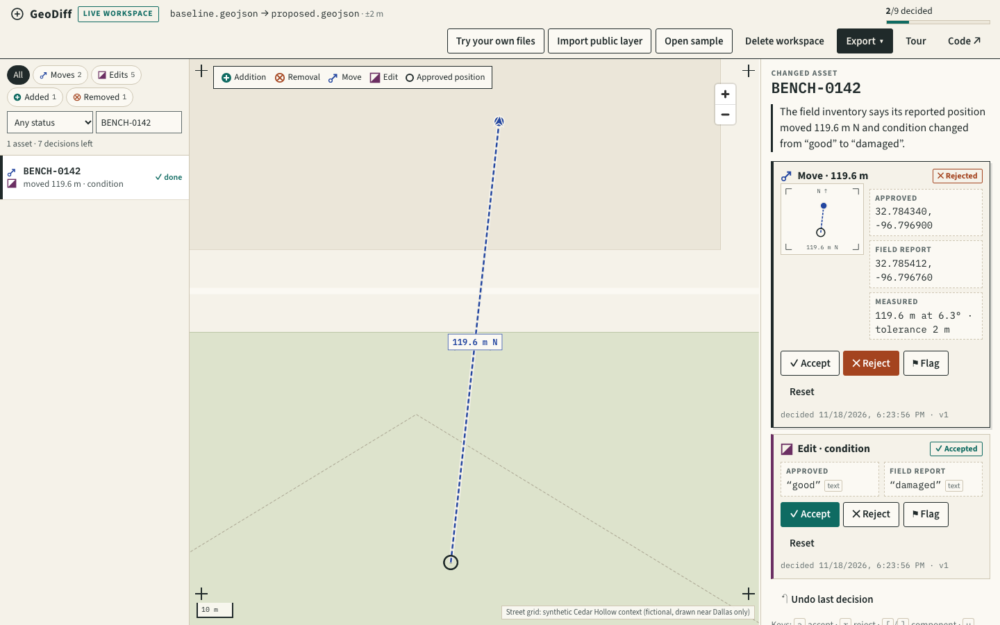

# GeoDiff

GeoDiff helps a GIS analyst reconcile a field inventory of point assets with last month's
approved inventory. It finds additions, deletions, significant moves and edited attributes.
The analyst reviews the evidence, records a decision on each change, and exports an inventory
containing only the approved updates. Source files are never modified.



- **Public demo:** not deployed yet (Phase 7). Until then, run it locally (below).
- **Walkthrough video (68 s, no audio):** [docs/media/walkthrough.webm](docs/media/walkthrough.webm)
- Stack: React 19 + TypeScript + Vite + MapLibre GL JS · FastAPI · PostgreSQL 17 / PostGIS 3.5 ·
  pyproj · Shapely

Two modes:

- **Guided sample** (default): a synthetic 400-asset park inventory for the fictional town of
  Cedar Hollow. It runs entirely in the browser from a bundle precomputed by the Python
  engine, and keeps decisions in local storage. It works with the API down.
- **Live workspace:** upload your own GeoJSON, or snapshot a curated public ArcGIS layer (NPS
  Yosemite points of interest). Data lives in a private, temporary workspace on the API.

## Run locally

```sh
docker compose up --build -d --wait
open http://localhost:8080
```

See [docs/SETUP.md](docs/SETUP.md) for versions, development and check commands.

## Case study

### Problem

Field crews collect asset updates (a bench is damaged, a fountain was removed, a new bike
rack was installed) in mobile apps that export a whole new copy of the inventory. Comparing
that copy with the approved inventory by eye misses changes. Comparing it naively flags
hundreds of false changes: GPS jitter of a metre, importer timestamps, `142` versus `"142"`,
or `null` versus a missing field. Worse, an accepted bad edit, such as a bench "moved" 120 m
into a residential block, silently corrupts the system of record.

GeoDiff makes every change an explicit, evidenced decision. Each changed attribute and each
move is a separate component the analyst can accept or reject, so a correct condition update
can be accepted while an implausible move on the same asset is rejected.

### Architecture

```
browser (React, MapLibre)
 ├─ SampleAdapter ── sample.json (precomputed by the engine) + localStorage
 └─ LiveAdapter ──── HTTPS ── FastAPI ── PostGIS (private; workspaces, decisions, history)
                                └─ engine (pure Python: parse, compare, resolve)
                                └─ ArcGIS importer (allowlisted public layers, read-only)
```

- **One engine.** `api/geodiff/engine` alone decides what a change is. The API, the CLI and
  the sample bundle all call it. The browser has a TypeScript port of only the *resolve* step
  (applying decisions), and tests check that it matches the Python output exactly at all
  three tolerance presets.
- **One review interface, two adapters.** The UI talks to a `ReviewAdapter`. The live adapter
  calls the API; the sample adapter reproduces the same semantics (versioned decisions, stale
  conflicts, notes required for flags, undo, final-export lock), so the sample is an honest
  preview of the live product.
- **PostGIS stores and serves.** Comparisons are stored per workspace with spatial indexes
  for viewport queries. Decisions carry versions to detect concurrent edits, and every change
  is in an append-only history used for undo and the export report.

### Key decisions

| Decision | Why |
|---|---|
| Match only by a chosen ID field, never by position | Position matching turns a move into a delete plus an add, and hides the move |
| Geodesic distance (Karney, WGS84), strict `>` tolerance | Correct at any latitude and across the antimeridian; cross-checked against PostGIS to 1 mm |
| JSON types stay distinct (`"5"` ≠ `5`, `null` ≠ absent) | Type drift from field apps is a real change the analyst should see |
| Unselected fields always come from the baseline | Bookkeeping fields and unreviewed edits never leak into the output |
| Final export locked until every component is decided; draft always available | No partial review becomes the system of record by accident |
| Anonymous, token-scoped workspaces with a 72 h sliding expiry | No accounts to manage; token hashed at rest, never in URLs; other workspaces return 404 |
| Public layers from a server-side allowlist only | The browser sends an ID, never a URL; no redirects, no tokens, read-only queries |
| Sample precomputed by the real engine | The demo works without the API and cannot drift from engine behaviour (a test rebuilds it) |

### Results (measured 2026-11-18, Apple M1, details in [docs/BENCHMARKS.md](docs/BENCHMARKS.md))

- **Detection on the labeled synthetic fixture:** 543 of 543 labeled changes found with no
  false positives at 5,000 assets (precision and recall 1.000; also 119/119 at 1,000 and
  1,074/1,074 at 10,000). 0 of 910 within-tolerance GPS motions were flagged. The generator
  was written with the engine, so this verifies consistency with the stated rules, not
  real-world accuracy.
- **Hand-authored goldens:** the expected change set and the reviewed output for a 13-asset
  pair were written by hand. The engine, the browser resolver and the full browser journey
  (upload → decide → final export) all reproduce them exactly.
- **Speed:** a 5,000-asset compare takes 31 ms of engine time. Through the API (loopback
  HTTP + PostGIS) it takes 376 ms; a 200-asset queue page takes 38 ms; a draft export takes
  182 ms. 10,000 assets compare in 78 ms of engine time.
- **Tests:** 129 API tests against real PostGIS, 17 browser unit tests, and 13 Playwright
  journeys (including accessibility scans with axe, keyboard-only review, 390 px phone width,
  no WebGL, API outage, and the sample with every API request blocked). CI runs them on each
  push, except one API test and one Playwright journey that need the real ArcGIS server and
  were run locally.

### Limitations

- Points only (no lines or polygons), GeoJSON in WGS84 only, 10,000 features and 5 MB per file.
- A coordinate range check cannot detect projected data that happens to look like degrees.
- No user accounts; anyone with the workspace token can review in that workspace.
- Detection accuracy is measured only on synthetic data. The manual QGIS cross-check in
  [docs/QGIS_VERIFY.md](docs/QGIS_VERIFY.md) is written but **has not been run**, and no
  screen-reader pass has been done beyond the automated axe checks.
- One curated public source. Two snapshots of it taken minutes apart are usually identical,
  so live public comparisons often show no changes; the importer is the feature, not the diff.
- All sample data is synthetic. Cedar Hollow does not exist, and no change shown in the demo
  was reported by any city.

## Documentation

- [docs/ENGINE.md](docs/ENGINE.md): input contract, ID policy, movement, resolution rules
- [docs/API.md](docs/API.md): live workspace API, isolation, limits
- [docs/SOURCES.md](docs/SOURCES.md): the public ArcGIS source and why others were rejected
- [docs/BENCHMARKS.md](docs/BENCHMARKS.md): method, environment and results
- [docs/DEPLOY.md](docs/DEPLOY.md): free-tier hosting, setup, rollback and backups
- [docs/PROGRESS.md](docs/PROGRESS.md): phase-by-phase build log with verification
